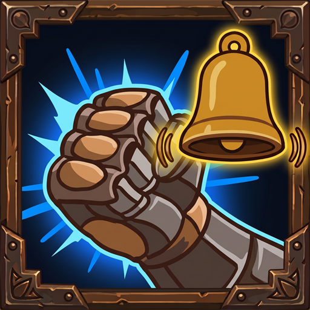

# wowkit

TypeScript packages and addons for World of Warcraft: Forever (1.60.x, TOC `16001`), compiled to Lua with
[TypeScriptToLua](https://github.com/TypeScriptToLua/TypeScriptToLua). The WoW API typings are generated from
Blizzard's own API documentation in [Gethe/wow-ui-source](https://github.com/Gethe/wow-ui-source/tree/forever)
(`forever` branch), so they match the client version exactly.

**Documentation:** https://vattiss.github.io/wowkit/ - a getting started page, a learning guide that builds a first addon, the architecture and the API reference.

## Design goal

wowkit is a TypeScript layer written to be **read by people**. An AI writes most of the code; the design makes sure a
person can still read it, review it, trust it and change it. Names read like English, files and functions are small,
each class has one job and is wired by hand, the game's quirks stay in one package, and the reasons for each choice are
written down. Every rule is checked by `pnpm check`, so it holds for any change, whoever wrote it. More, and what it
does not promise: [Design goal](docs/design-goal.md).

## The addons

One addon that lights up your action bars, so you look at the buttons you press anyway and not at an extra window. It has
a Settings page (*Options > AddOns*) and saves its settings per character.

| | Addon | What it lights up |
|---|---|---|
|  | [Glowing Bars](addons/glowing-bars/README.md) | Missing buffs and weapon buffs, buffs that are on no action bar, party members who miss your buff, spells at an old rank, low reagents, important cooldowns that are ready, and procs (Overpower, Revenge, Execute...). |

It replaces Buff Reminder, Rank Reminder and Reagent Reminder (and retires Know Your Rotation); their last releases
(`1.0.2`) point here. Their code is in the history, at the tags `buff-reminder-v1.0.2` and so on.

Only Blizzard's own action bars are supported.

## Development

Requires Node.js 24+ (the build scripts are TypeScript run by Node directly), [pnpm](https://pnpm.io) (`npm install -g pnpm`) and, for tests, LuaJIT or another Lua 5.1.

```sh
pnpm install
pnpm build        # every addon -> addons/<name>/dist/<AddonName>/{<AddonName>.toc,<AddonName>.lua}
pnpm test         # checks, build, then the tests of every addon and of the core and wow packages (TypeScript, see addons/glowing-bars/test/README.md); CI runs the same
pnpm typecheck
pnpm format       # Prettier writes the code layout; pnpm test only checks it
pnpm --filter glowing-bars watch   # rebuild on change

# copy one addon's build into the game (then /reload); the Forever beta installs into _classic_beta_
WOW_ADDONS_DIR="C:/Program Files (x86)/World of Warcraft/_classic_beta_/Interface/AddOns" pnpm --filter glowing-bars deploy:game
```

### Layout

The documentation site is at https://vattiss.github.io/wowkit/ (built from `docs/` and the TypeDoc API reference; `pnpm docs:dev` runs it locally).
New here: [docs/getting-started.md](docs/getting-started.md), then the [learning guide](docs/learning-guide.md) that builds a first addon.

Diagrams of the build pipeline, the features and the events: [docs/architecture.md](docs/architecture.md).
The words used in the code (buff, aura, buff category, group version...): [docs/glossary.md](docs/glossary.md).
Why the code is so defensive (the game's quirks): [docs/forever-quirks.md](docs/forever-quirks.md).
Why the project is built the way it is (the architecture decision records, ADR): [docs/architecture.md](docs/architecture.md#architecture-decision-records-adr).
How the code is split into packages, and what a second addon would take: [docs/packages.md](docs/packages.md).
How an addon is released to CurseForge: [docs/releasing.md](docs/releasing.md).
Each folder has a short README.

```
packages/       a folder per scope, then per package (packages/README.md); each imports only what it depends on
  @wowkit/          the toolkit, for any Forever addon
    core/             Addon (starts the services), lifecycle hooks, EventBus, @OnGameEvent,
                      @OnUnitEvent, @OnEvent, @Interval, text helpers
    wow/              the door to the game: spells, auras, action bars, player, party, bags,
                      clock, glows and notices, saved variables, protected calls
    ui/               settings, texts, chat lines and sounds, the pages of the Settings panel
    wow-types/        the typings of Blizzard's API
    wow-data/         the spell and item IDs the addons use, by category, and what the client said of them
      generated/        generated from Blizzard's API docs - do not edit
      wow-manual.d.ts   hand-written typings: script handlers, CreateFrame, string unions
      wow-framexml.d.ts hand-written typings: Settings panel API, action buttons, FrameXML globals
    test-kit/         describe / it / expect, a fake game and its fixtures
addons/
  glowing-bars/ the addon: reminders, old ranks, reagents, ready cooldowns and procs, all as glows on the bars
    src/              the addon's sources; a folder per feature
      main.ts           entry point: startAddon()
      addon.ts          makes every service with `new`, dependencies first; that order is the order of the lifecycle hooks
      settings/         the shape and defaults of the settings, the glow colors
      locale/           the texts
      knowledge/        what only this addon knows - buff categories
      reminders/        missing buffs, weapon buffs, party buffs, old ranks, the reagents on arriving in a town; the buff lists
      reagents/         the reagents of the group buffs, and whether the bags hold them
      glows/            ready cooldowns and procs: the lists per class, the cooldown tracker
      tick/             a tick every 0.2 s - find what is due, show it; when to look sooner
      character/        what happens to the player (weapons, auras and casts, the party roster, blocked actions)
      options/          the Settings panel pages
    addon/            static addon files (the TOC); its @version@ is filled from package.json
    assets/           logo.png: the one source of the logo; the build makes the game's icon (images/logo.tga) from it
    test/             the specs: describe / it in TypeScript against the fake game (test/README.md)
  wowkit-check/      developer tool, not released: asks the client about the IDs in wow-data (/wowkit check)
scripts/        build, deploy, zip, type-generation and check scripts
docs/           architecture (with the reasons), packages, releasing, glossary, the game's quirks
```

### Rules

- **Only a few folders call the game:** `packages/@wowkit/wow/src/` (what the reminders ask the game),
  `packages/@wowkit/core/src/` (events and timers), and `addons/glowing-bars/src/options/` (the Settings panel). Reminder
  logic talks to `packages/@wowkit/wow/src/` in plain terms (`isInCombat()`, `isLearned(spell)`) and never sees secret values,
  protected calls or remapped IDs.
- **Everything is a service, made once, by hand:** plain classes that take what they need in the constructor,
  made in `addons/glowing-bars/src/addon.ts`; no inheritance, no container; services are built from other services.
- **The packages do not know the addon:** each package imports only itself and the packages it depends on
  (`pnpm check` enforces it); `addon.ts` passes in what a package asks for (buff categories, spell names).
- **Names read like English:** functions start with a verb, booleans read as questions (`isFound`).

`pnpm check` enforces the folder and naming rules, the compiler checks the wiring in `addon.ts`;
`pnpm test` runs both.

### WoW API typings

`packages/@wowkit/wow-types/generated/` is committed, so a normal build needs no network access. To move to a newer client build:

```sh
pnpm fetch:wow-ui:latest   # sparse-clones the API docs into .cache/ and pins the new commit in package.json
pnpm gen:types             # regenerates packages/@wowkit/wow-types/generated/*.d.ts
pnpm typecheck
```

(`pnpm fetch:wow-ui` re-fetches the commit that is already pinned.)

What gets generated from `Blizzard_APIDocumentationGenerated`:

- `C_*` namespaces and global functions (`wow-api.d.ts`), including `Constants.*`
- `Enum.*` (`wow-enums.d.ts`), structures and callback types (`wow-structures.d.ts`)
- `WowEventPayloads` / `WowEvent`: every event with its payload types (`wow-events.d.ts`)
- widget interfaces (`Frame`, `Button`, `Texture`, ...) with methods called as `obj:Method()` (`wow-widgets.d.ts`)
- `wow-unresolved.d.ts`: names the docs use but never define, typed `any` - declare them in
  `wow-manual.d.ts` or map them in `PRIMITIVES` in `scripts/generate-types/knowledge.ts` to tighten them up

Where the docs are wrong or incomplete (overloads such as `SetPoint("CENTER")`, `C_Timer.NewTicker`'s return
type), fix it with `SIGNATURE_OVERRIDES` in the generator or extra overloads in `wow-manual.d.ts`.

### TypeScriptToLua notes

- `noImplicitSelf` is on: plain functions and namespace functions are called with `.`, interface methods with `:`.
  Script handlers get the widget as an explicit first parameter: `frame.SetScript("OnEvent", (self, event, ...args) => ...)`.
- Use `@OnGameEvent("EVENT_NAME")` on a method for typed event payloads (a handler with the wrong parameters does not compile).
- No `RegExp`: use Lua patterns via `string.match` / `string.gsub` / `string.gmatch`.
- A function-valued property called through `?.` (`setting?.set(x)`) is compiled as a method call and gets
  an extra `self`. Declare it with `this: void` (`set: (this: void, x: unknown) => void`) or call it without `?.`.
- A closure only sees variables declared before it; declare a variable before the function that uses it.
- Arrays are Lua sequences (1-based in Lua, 0-based in TS - TSTL translates the indices).
- Globals such as SavedVariables are declared with `declare global { var Name: Type }`.
- Classes work (methods are called with `:`); pass methods as callbacks wrapped in an arrow function.
- No import cycles: the bundle's `require` does not support them. Lower services notify upper ones
  with events on the `EventBus` (`@OnEvent`); the packages import nothing from the addon.
- Decorators (`@OnGameEvent`, `@Interval`...) need `experimentalDecorators`; a method is called as
  `instance[name](instance, ...)`. See `packages/@wowkit/core/README.md`.

## License

[MIT](LICENSE).
