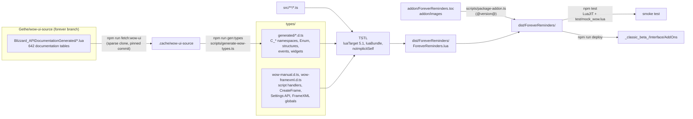
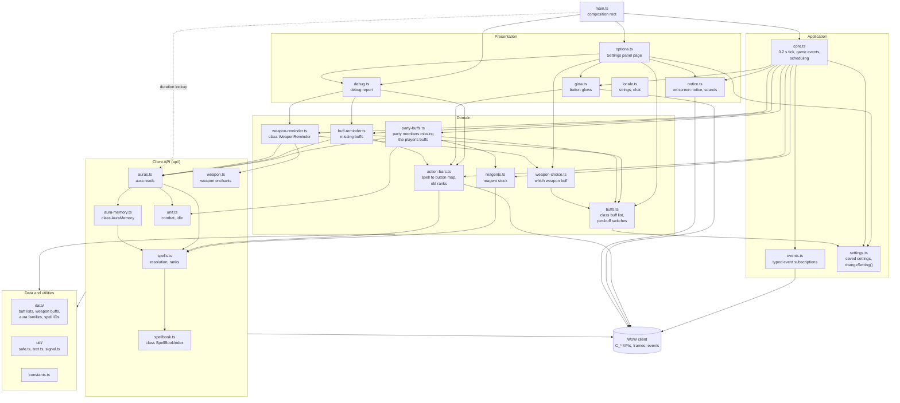
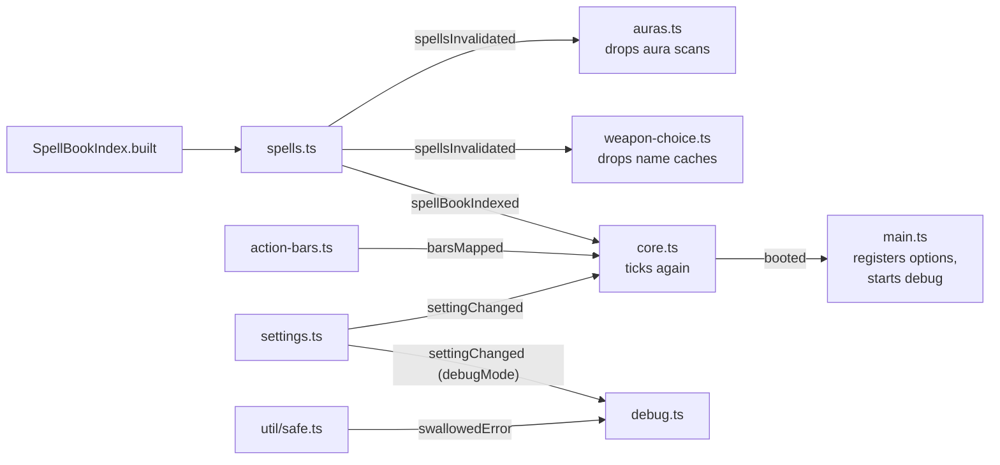
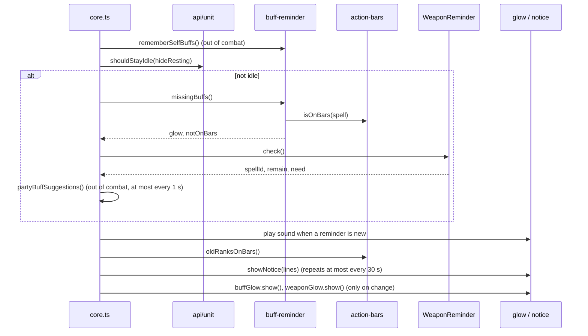

# Architecture

Forever Reminders is a World of Warcraft: Forever addon written in TypeScript and compiled to a
single Lua file. This page shows how it is built and how its modules depend on each other at run
time.

## Build pipeline

The WoW API typings are generated from Blizzard's own API documentation; the addon is compiled to
one Lua 5.1 file by TypeScriptToLua (TSTL) and packaged with its TOC.

## Run-time layers

Dependencies point downwards only. `api/`, `data/` and `util/` import nothing from the layers
above them; when a lower module has news for an upper one, it fires a signal (see below).
`main.ts` is the composition root: the only place that wires modules together.

## Signals (notifications upwards)

TSTL bundles modules with `require`, which cannot resolve import cycles, so lower modules never
import upper ones. They expose a signal (`util/signal.ts`) and the upper module subscribes.

## One tick

Every 0.2 seconds (and on the next frame after relevant events) the core decides what glows and
what the notice says.

