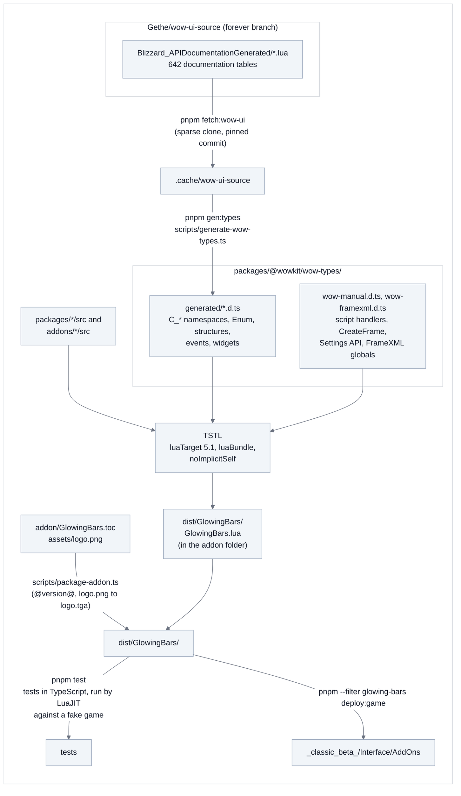
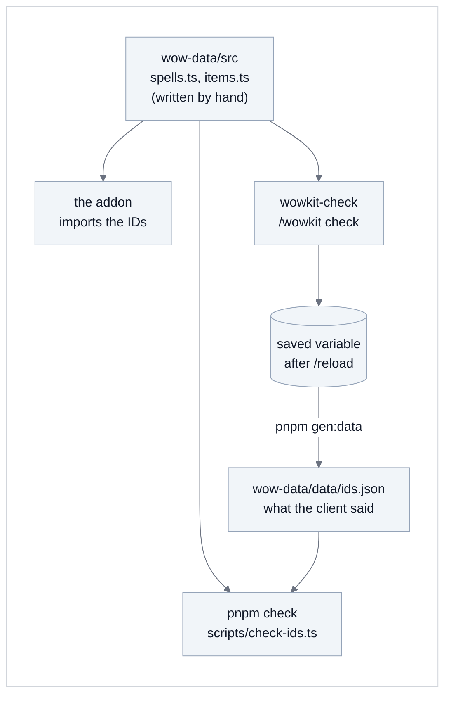
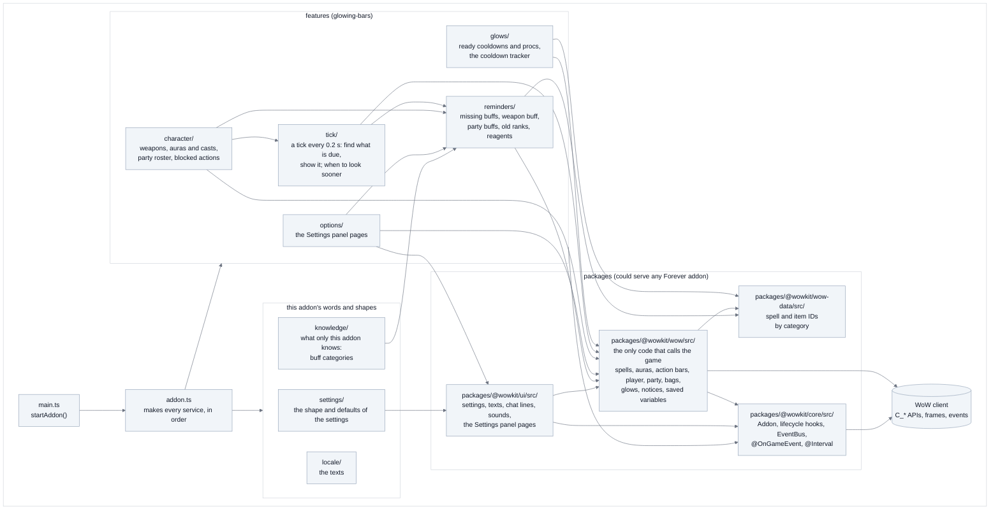
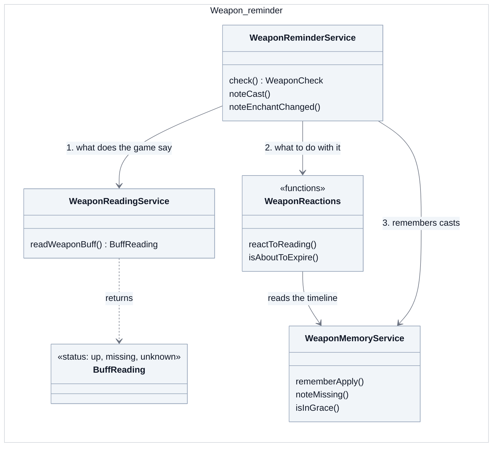
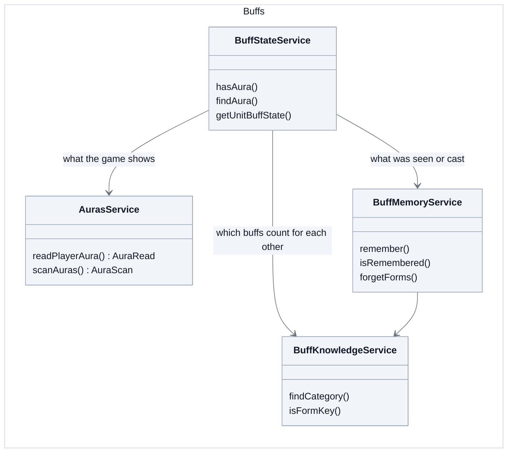
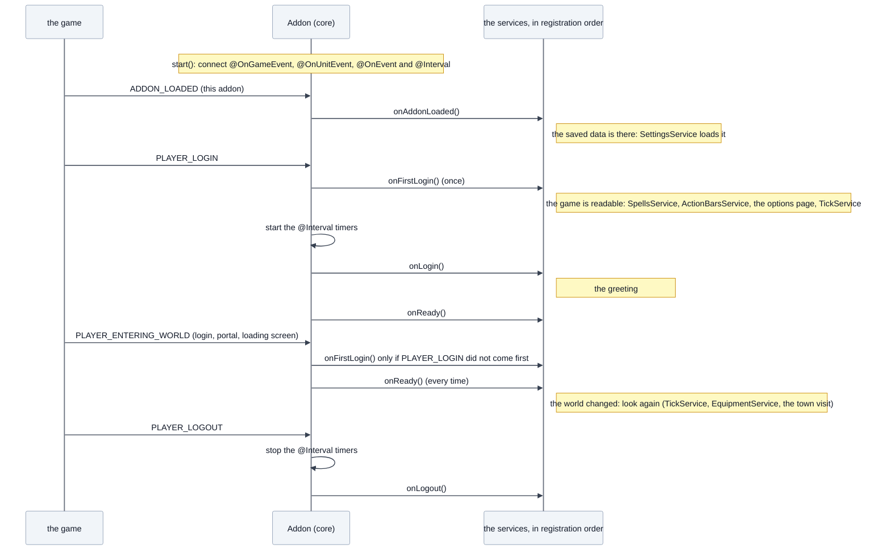
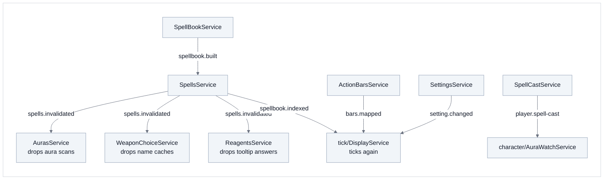
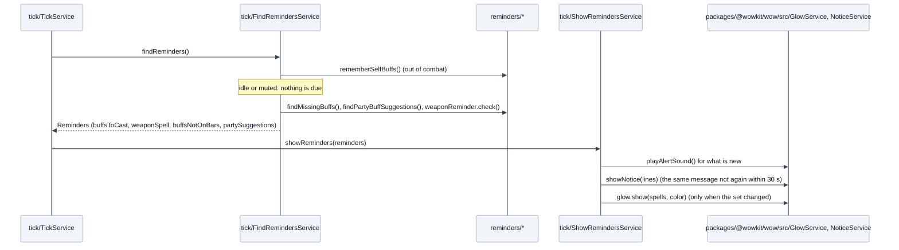

# Architecture

The addon of this repository (Glowing Bars) is written in TypeScript on shared packages, and compiled to a
single Lua file. This page shows how an addon is built (Glowing Bars as the example), how the code is organised,
and the rules that keep it readable. The packages and the addons:
[packages.md](packages.md).

## The four rules

**1. Only a few folders talk to the game.**
Blizzard's API is full of quirks: values that are secret in combat, calls that can raise errors,
spell IDs that Forever remaps, `multiple, return, values`. All of that stays inside `packages/@wowkit/wow/src/`, which
turns it into plain answers in the addon's own words (`isInCombat()`, `isLearned(spell)`,
`getItemCount(item)`). The reminder logic in `addons/glowing-bars/src/reminders/` never sees a Blizzard function, so it reads
like plain code. A few more places may call the game because that is their job: `packages/@wowkit/core/src/` (game events and timers for
the decorators), `packages/@wowkit/ui/src/` (the Settings panel and the chat) and the `options/` folders of the addons (their
own page).

**2. Everything is a service, made once, by hand.**
Code that keeps state, talks to the game or uses other services is a class with its dependencies in the
constructor. `addons/glowing-bars/src/addon.ts` makes each one with `new`, dependencies first, so there is one instance of each; there
is no inheritance and no container (a service is built from the services it is given). Pure data is a
`*.constants.ts` file, a shape is a `*.interface.ts` file, and a helper only one class uses is a private method of that class. Only
helpers that several files share stay plain functions, in a file of their own (`packages/@wowkit/core/src/utils/text.utils.ts`,
`packages/@wowkit/wow/src/utils/protected-call.utils.ts`, `packages/@wowkit/wow/src/utils/secret-value.utils.ts`,
`reminders/weapon/weapon-reactions.ts`).

**3. The packages do not know the addon.**
`packages/@wowkit/` (core, wow, ui, wow-data, test-kit and the typings) could serve any Forever addon, so each
imports only itself and the packages it depends on. What only an addon knows (the buff knowledge, the shape of its settings, its texts, the name of
the saved variable) is a constructor or type parameter, passed in by the addon's `addon.ts`. See [packages.md](packages.md).

**4. Names read like English.**
Functions start with a verb (`getSpellName`, `findMissingBuffs`, `showNotice`). Booleans read as
questions (`isFound`, `hasArrived`, `shouldRecheckDrop`).

All four rules are checked by `pnpm check` (part of `pnpm test`) or by the compiler, so
they cannot creep back in.

## Build pipeline

The WoW API typings are generated from Blizzard's own API documentation; the addon is compiled to
one Lua 5.1 file by TypeScriptToLua (TSTL) and packaged with its TOC.

## The IDs of spells and items

The spell and item IDs the addons use are written **once**, by category, in `@wowkit/wow-data`
(`src/spells.ts`: `Paladin.BlessingMight`, `Shaman.Windfury`; `src/items.ts`: `Reagents.HolyCandle`), and the code imports them
from there. Blizzard's API documentation does not say which spell is which ID, so the game is asked: the developer
addon `wowkit-check` (not released) goes through the same tables with `/wowkit check` and saves what the client says, and
`pnpm check` compares the tables with that answer, so a wrong or remapped ID fails without the game.

See [wowkit-check](../addons/wowkit-check/README.md) and [wow-data](../packages/@wowkit/wow-data/README.md).

## Code layout

`main.ts` calls `startAddon` in `addon.ts`, which makes every service; every box below is a folder of
services. An arrow means "uses services of".

The packages ask the addon for what only it knows, as constructor or type parameters, and `addon.ts` passes it: the buff
knowledge (`BuffKnowledgeService` from `knowledge/`), the shape and defaults of the settings (`settings/`), the texts
(`locale/`) and the name of the saved variable (`settings/`).

## Design patterns

The code is plain classes, but they follow a few well-known patterns, and the structure is easier to see when they
are named. Each colour below is one pattern; a grey box is plain domain code with no pattern of its own.

```mermaid
%%{init: {"theme":"base","themeVariables":{"background":"#ffffff","lineColor":"#6b7280","textColor":"#111827","primaryColor":"#f1f5f9","primaryTextColor":"#111827","primaryBorderColor":"#94a3b8","secondaryColor":"#e2e8f0","tertiaryColor":"#ffffff","mainBkg":"#f1f5f9","nodeBorder":"#94a3b8","nodeTextColor":"#111827","titleColor":"#111827","edgeLabelBackground":"#ffffff","labelBackground":"#ffffff","labelTextColor":"#111827","clusterBkg":"#ffffff","clusterBorder":"#d1d5db","classText":"#111827","actorBkg":"#f1f5f9","actorTextColor":"#111827","actorBorder":"#94a3b8","actorLineColor":"#6b7280","signalColor":"#374151","signalTextColor":"#111827","noteBkgColor":"#fef9c3","noteTextColor":"#111827","noteBorderColor":"#ca8a04"}}}%%
flowchart TB
    classDef default fill:#f1f5f9,stroke:#94a3b8,color:#111827
    classDef panel fill:#ffffff,stroke:#d1d5db,color:#111827
    classDef root fill:#e5e7eb,stroke:#4b5563,color:#111827
    classDef facade fill:#dbeafe,stroke:#2563eb,color:#111827
    classDef observer fill:#ffedd5,stroke:#ea580c,color:#111827
    classDef pipeline fill:#dcfce7,stroke:#16a34a,color:#111827
    classDef state fill:#f3e8ff,stroke:#9333ea,color:#111827
    classDef invert fill:#fee2e2,stroke:#dc2626,color:#111827
    classDef plain fill:#f8fafc,stroke:#94a3b8,color:#111827

    subgraph PANEL[" "]
        subgraph ROOT["Composition root + lifecycle hooks"]
            wiring["addon.ts<br/>makes every service with new,<br/>dependencies first"]
            addon["Addon (core)<br/>register(), start(),<br/>onAddonLoaded ... onLogout"]
        end

        subgraph FACADE["Facade + Adapter over Blizzard's API (@wowkit/wow)"]
            wow["PlayerService, SpellsService, AurasService,<br/>ActionBarsService, PartyService, BagsService,<br/>WeaponEnchantsService, ClockService,<br/>GlowService, NoticeService, SavedVariablesService<br/>protected-call.utils.ts, secret-value.utils.ts"]
        end

        subgraph INVERT["Dependency inversion"]
            knowledge["SettingsService&lt;T&gt;, LocaleService&lt;K&gt;<br/>the shape of the settings, the texts,<br/>the saved variable name"]
        end

        subgraph OBSERVER["Observer / Pub-Sub"]
            bus["EventBus + @OnGameEvent, @OnUnitEvent,<br/>@OnEvent, @Interval"]
            handlers["Listeners: AuraWatch, Equipment, Roster,<br/>BlockedAction, Display,<br/>RefreshService, SpellRefresh, BarRefresh"]
        end

        subgraph PIPELINE["Pipeline: find, then show"]
            tick["TickService (every 0.2 s)"] --> find["FindRemindersService"] --> show["ShowRemindersService<br/>NoticesService"]
            refresh["RefreshService<br/>merges and delays requests<br/>(debounce)"] -.-> tick
        end

        subgraph STATE["State by reading + memory (weapon reminder)"]
            weapon["WeaponReminderService<br/>WeaponReadingService<br/>weapon-reactions (one reaction per status)<br/>WeaponMemoryService"]
        end

        subgraph RULES["Domain services: the rules"]
            rules["ClassBuffsService, BuffReminderService,<br/>PartyBuffsService, WeaponChoiceService"]
        end

        subgraph SHARED["Shared services (@wowkit/ui)"]
            shared["SettingsService, LocaleService,<br/>MessagesService"]
        end

        subgraph SCREEN["The Settings page"]
            screen["Options pages, ControlsService (control factory),<br/>WidgetsService, AboutSection"]
        end

        game[("WoW client")]

        wiring --> addon
        wow --> game
        rules -->|asks the game through| wow
        weapon -->|reads enchants and auras through| wow
        find -->|asks what is due| rules
        find -->|asks| weapon
        knowledge -.->|passed in by addon.ts| wow
        wow -.->|announces events| bus
        shared -.->|announces setting.changed| bus
        bus -.->|calls| handlers
        handlers -.->|ask to look again| refresh
        screen --> shared
        screen --> rules
    end

    class PANEL panel
    class ROOT,wiring,addon root
    class FACADE,wow facade
    class INVERT,knowledge invert
    class OBSERVER,bus,handlers observer
    class PIPELINE,tick,find,show,refresh pipeline
    class STATE,weapon state
    class RULES,rules,SHARED,shared,SCREEN,screen,game plain
```

| Colour | Pattern | Where | What it gives |
|---|---|---|---|
| ⬜ | **Composition root**, lifecycle hooks (Template Method) | `addon.ts`, `Addon` | One file shows what depends on what; a service only says *when* it wants to run (`onLogin`...). |
| 🟦 | **Facade** + **Adapter** | `@wowkit/wow`, `protected-call.utils.ts`, `secret-value.utils.ts` | The rest of the code never sees secret values, protected calls or remapped IDs, only `isInCombat()`. |
| 🟧 | **Observer** (publish / subscribe) | `EventBus`, the event decorators | Lower code announces ("spells.invalidated"), upper code listens; no import cycles (the Lua bundle cannot have them). |
| 🟩 | **Pipeline** (+ **debounce**) | `tick/` | *Find* has no side effects and *show* remembers only what it showed; a burst of events becomes one tick. |
| 🟪 | **State** by reading, **Memento** | `reminders/weapon/` | The game's answer (up, missing, unknown) picks one small reaction function; a timeline remembers what the client lags on. |
| 🟥 | **Dependency inversion** | `SettingsService<T>`, `LocaleService<K>` | A package asks for what only the addon knows (the shape of its settings, its texts, the name of its saved variable), without importing the addon. |

Two of these in more detail.

**State by reading (the weapon reminder).** The client's weapon-enchant answers lag behind casts and are sometimes
missing, so the answer is not a plain read. The reminder asks the *reading* service what the game says (`up`,
`missing` or `unknown`), hands that reading to one reaction function chosen by the status, and keeps its own
timeline in the *memory* service.

**A facade under the addon's rules (the buffs).** `AurasService` of `@wowkit/wow` (blue) only says what the game
shows: the player's aura of a spell, or the list of a unit's auras, and which of them the client hid. What that means
is Buff Reminder's (purple): `BuffStateService` puts it together with the buff categories (`BuffKnowledgeService`: any
aspect counts for an aspect, a group version for the single buff) and the memory that fills in while the client hides
the auras in combat (`BuffMemoryService`).

## Lifecycle: when a service runs

A service does not listen to the game's start-up events itself. It has a method of a fixed name, and `Addon.start()`
calls it at the right moment. Each hook runs on every service that has it, **in the order the services were registered**
in `addon.ts`, so a service is registered after the ones it needs.

| Hook | When | How often |
|---|---|---|
| `onAddonLoaded` | `ADDON_LOADED` of this addon: the saved variables exist | once |
| `onFirstLogin` | the first `PLAYER_LOGIN` or `PLAYER_ENTERING_WORLD`: the game can be read | once |
| `onLogin` | `PLAYER_LOGIN` only (not a loading screen) | once per session |
| `onReady` | after `PLAYER_LOGIN` and after every `PLAYER_ENTERING_WORLD` | many times |
| `onLogout` | `PLAYER_LOGOUT`, after the timers stopped | once |

The hooks are the interfaces `OnAddonLoaded` ... `OnLogout` in `packages/@wowkit/core/src/types.ts`; the code that calls them is `packages/@wowkit/core/src/addon.ts`.

## Events (notifications upwards)

TSTL bundles modules with `require`, which cannot resolve import cycles, so a lower service never imports an
upper one. It emits a named event on the `EventBus` (Nest's EventEmitter) and the upper service listens with
`@OnEvent("name")`. Each event is declared next to the service that emits it, by adding to `AppEvents`.

## One tick: a two-stage pipeline

Every 0.2 seconds (`@Interval(200)`, and on the next frame after relevant events) a tick runs. It has two stages
and one value passed between them, so the stage that decides never shows anything, and the stage that shows
never decides.

The triggers are separate: each service says with decorators which game event it reacts to
(`@OnGameEvent`, `@OnUnitEvent`), and `tick/refresh.service.ts` merges and delays the requests (event bursts froze
Forever once), then calls `tick`. The first read of the game, the options page, the greeting and logout are
lifecycle hooks (`onFirstLogin`, `onLogin`, `onLogout`).

## Architecture decision records (ADR)

The choices that shaped the project, and the reason each was made, one record each. When one of them stops being true,
change its record here.

- **Forever only, with its own typings.** The addons are for World of Warcraft: Forever (1.60.x) and nothing else, so
  there is no compatibility layer. The typings are generated from Blizzard's own API documentation for that client, and
  the raw API stays reachable: a package wraps it in plain answers, it never hides it.
- **The packages are compiled into each addon.** Each addon is one Lua file that carries what it uses of the packages.
  There is no shared addon to install, so no load order, no version clash, and an addon works without the others.
- **Our own `describe` / `it` runner on LuaJIT** (`@wowkit/test-kit`), against a fake game whose functions are checked
  against the real API types. The tests are TypeScript, run the built Lua, and need no game.
- **Plain classes, wired by hand.** A service takes what it needs in its constructor, and `addon.ts` makes every service
  with `new`, dependencies first. There is no container and no `@Inject`: TypeScriptToLua has no `emitDecoratorMetadata`,
  so a container made every dependency be written twice, and a mistake showed only when the addon started. The compiler
  checks the wiring now, and a cycle cannot be written. Decorators remain only for what a method listens to
  (`@OnGameEvent`, `@OnEvent`, `@Interval`) and the lifecycle hooks are methods of a fixed name.
- **The packages do not know the addons.** What only an addon knows (its buff lists, its texts, the shape of its settings)
  reaches a package as a constructor or type parameter. `pnpm check` fails on an import that goes the wrong way.
- **Packages and addons in one pnpm workspace, compiled from sources.** TypeScriptToLua cannot compile sources it finds
  through `node_modules` (it takes them for precompiled Lua), so the `tsconfig` `paths` point at the package sources.
  Publishing would need library builds; it is not done and not needed until another repository wants the packages.
- **One addon, not several.** Buff, rank and reagent reminders were three addons that shared infrastructure; players
  wanted one thing that lights up the action bars, and the glows (buffs, old ranks, ready cooldowns, procs) are one idea.
  The old ones are kept in the history, at their last tags. The shared parts stay packages (`ui` for the settings and the
  Settings page, `wow` for the game's door).
- **One page per addon, and no debug report.** The addons are small; a landing page with sub pages only added clicks. The
  debug report was built to find out what the client answers while the first addon was written, and was never needed since.
- **State belongs to an object, not to a module.** A package that keeps its state in module variables cannot be tested
  (every test shares it), so the event frame belongs to an `Addon`, and a package reads the game's API when a service needs it,
  not when the file is loaded.
- **`@wowkit/wow` is the game's door and nothing else.** Logic about what the reminders remind of does not live there: the spell and
  item IDs are written once in `@wowkit/wow-data`, what an addon needs (the reagents of the group buffs, when to keep quiet) is in that addon. Reading the auras is a facade too: `AurasService` says what the game shows, and Buff Reminder's `BuffStateService` decides
  what it means (the memory while the client hides the auras, the buff categories).
- **`@wowkit/core` stays small:** `Addon`, the events and timers, the lifecycle hooks and the text helpers. Anything that talks
  to the game's API belongs in `@wowkit/wow`, and anything for the Settings panel in `@wowkit/ui`.
