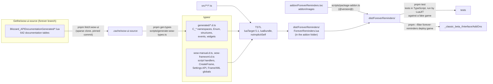
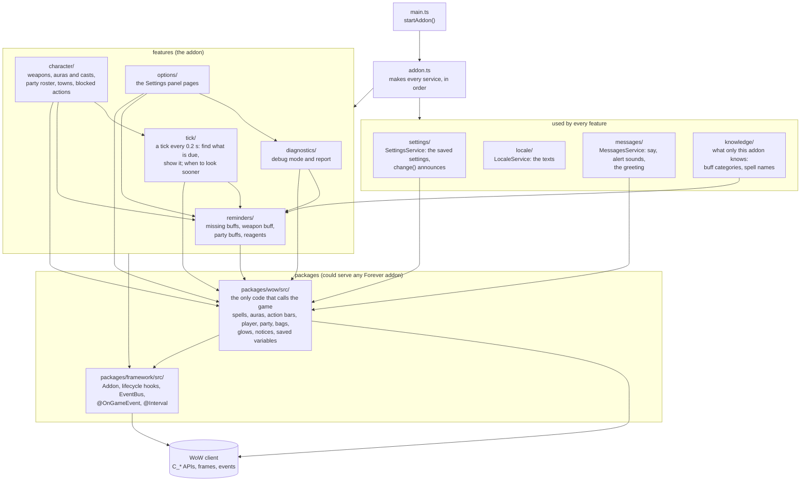
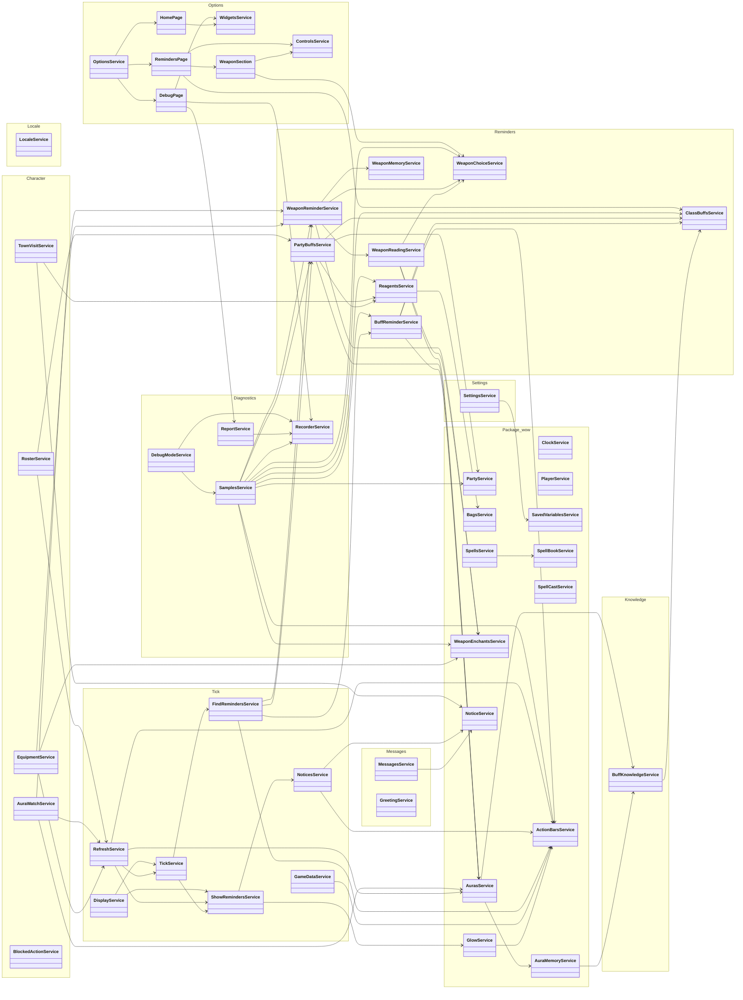
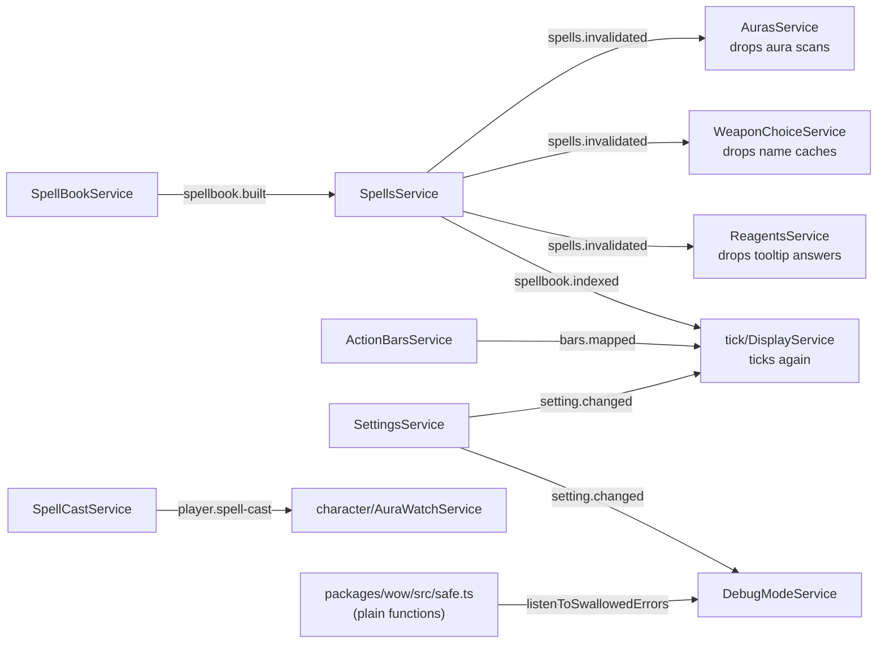
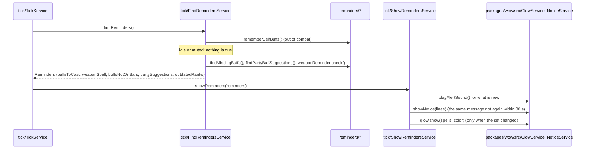

# Architecture

Forever Reminders is a World of Warcraft: Forever addon written in TypeScript and compiled to a
single Lua file. This page shows how it is built, how the code is organised, and the three rules that
keep it readable.

## The four rules

**1. Only a few folders talk to the game.**
Blizzard's API is full of quirks: values that are secret in combat, calls that can raise errors,
spell IDs that Forever remaps, `multiple, return, values`. All of that stays inside `packages/wow/src/`, which
turns it into plain answers in the addon's own words (`isInCombat()`, `isLearned(spell)`,
`getItemCount(item)`). The reminder logic in `addons/forever-reminders/src/reminders/` never sees a Blizzard function, so it reads
like plain code. Three more folders may call the game because that is their job: `packages/framework/src/` (game
events and timers for the decorators), `addons/forever-reminders/src/options/` (the Settings panel) and `addons/forever-reminders/src/diagnostics/` (the debug
mode, which probes what the game answers).

**2. Everything is a service, made once, by hand.**
Code that keeps state, talks to the game or uses other services is a class with its dependencies in the
constructor. `addons/forever-reminders/src/addon.ts` makes each one with `new`, dependencies first, so there is one instance of each; there
is no inheritance and no container (a service is built from the services it is given). Pure data is a
`*.constants.ts` file, a shape is a `*.interface.ts` file, and a pure function of its arguments stays a function
(`packages/framework/src/text.ts`, `packages/wow/src/safe.ts`, `reminders/weapon/weapon-reactions.ts`).

**3. The packages do not know the addon.**
`packages/` (framework, wow, test-kit and the typings) could serve any Forever addon, so each imports only itself
and the packages it depends on. What only this addon knows (the buff knowledge, the spell name hints, the name of
the saved variable) is a constructor parameter, passed in by `addons/forever-reminders/src/addon.ts`. See [packages.md](packages.md).

**4. Names read like English.**
Functions start with a verb (`getSpellName`, `findMissingBuffs`, `showNotice`). Booleans read as
questions (`isFound`, `hasArrived`, `shouldRecheckDrop`).

All four rules are checked by `pnpm check` (part of `pnpm test`) or by the framework when the addon starts, so
they cannot creep back in.

## Build pipeline

The WoW API typings are generated from Blizzard's own API documentation; the addon is compiled to
one Lua 5.1 file by TypeScriptToLua (TSTL) and packaged with its TOC.

## Code layout

`main.ts` calls `startAddon` in `addon.ts`, which makes every service; every box below is a folder of
services. An arrow means "uses services of".

The packages ask the addon for three things as constructor parameters, and `addon.ts` passes them: the buff
knowledge (`BuffKnowledgeService` from `knowledge/`), the spell name hints (`knowledge/`) and the name of the saved
variable (`settings/`).

## Classes

Every service as a box, grouped by folder; an arrow means "takes it in its constructor" (generated from
`addons/forever-reminders/src/addon.ts`). To keep the picture readable, the arrows to the services nearly everyone takes are left out:
`SettingsService`, `LocaleService`, `MessagesService`, `PlayerService`, `SpellsService` and `ClockService`.

## Events (notifications upwards)

TSTL bundles modules with `require`, which cannot resolve import cycles, so a lower service never imports an
upper one. It emits a named event on the `EventBus` (Nest's EventEmitter) and the upper service listens with
`@OnEvent("name")`. Each event is declared next to the service that emits it, by adding to `AppEvents`.

The helpers in `packages/wow/src/safe.ts` are plain functions and cannot be injected, so they report swallowed errors to a
listener (`listenToSwallowedErrors`) that `DebugModeService` registers.

## One tick: a two-stage pipeline

Every 0.2 seconds (`@Interval(200)`, and on the next frame after relevant events) a tick runs. It has two stages
and one value passed between them, so the stage that decides never shows anything, and the stage that shows
never decides.

The triggers are separate: each service says with decorators which game event it reacts to
(`@OnGameEvent`, `@OnUnitEvent`), and `tick/refresh.service.ts` merges and delays the requests (event bursts froze
Forever once), then calls `tick`. The first read of the game, the options page, the greeting and logout are
lifecycle hooks (`onFirstLogin`, `onLogin`, `onLogout`).
