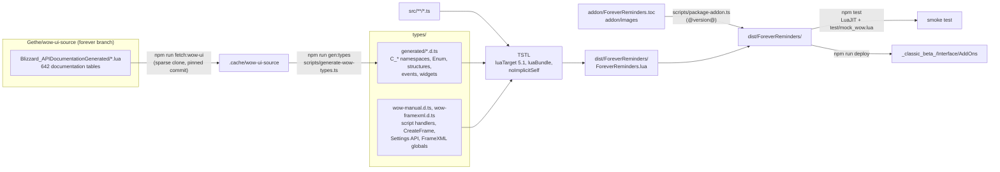
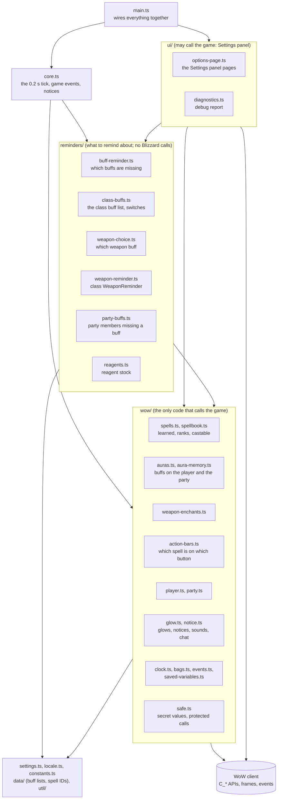
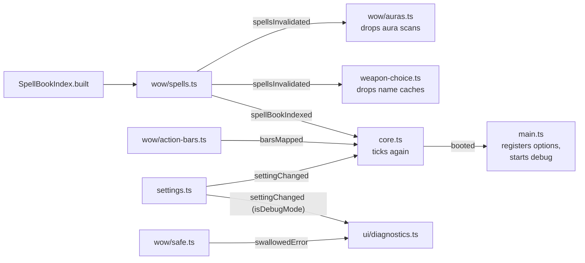
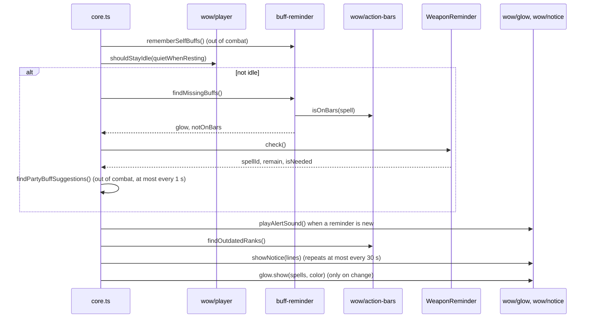

# Architecture

Forever Reminders is a World of Warcraft: Forever addon written in TypeScript and compiled to a
single Lua file. This page shows how it is built, how the code is organised, and the two rules that
keep it readable.

## The two rules

**1. Only `src/wow/` and `src/ui/` talk to the game.**
Blizzard's API is full of quirks: values that are secret in combat, calls that can raise errors,
spell IDs that Forever remaps, `multiple, return, values`. All of that stays inside `src/wow/`,
which turns it into plain answers in the addon's own words (`isInCombat()`, `isLearned(spell)`,
`getItemCount(item)`). The reminder logic in `src/reminders/` never sees a Blizzard function, so it
reads like plain code. `src/ui/` is the other place that may call the game, because the options page
and the debug report are built from the Settings panel API.

**2. Names read like English.**
Functions start with a verb (`getSpellName`, `findMissingBuffs`, `showNotice`). Booleans read as
questions (`isFound`, `hasArrived`, `shouldRecheckDrop`).

Both rules are checked by `npm run check` (part of `npm test`), so they cannot creep back in.

## Build pipeline

The WoW API typings are generated from Blizzard's own API documentation; the addon is compiled to
one Lua 5.1 file by TypeScriptToLua (TSTL) and packaged with its TOC.

## Code layout

Dependencies point downwards only. `wow/` imports no reminder logic and no settings; when it has
news for something above it, it fires a signal (see below).

## Signals (notifications upwards)

TSTL bundles modules with `require`, which cannot resolve import cycles, so lower modules never
import upper ones. They expose a signal (`util/signal.ts`) and the upper module subscribes.

## One tick

Every 0.2 seconds (and on the next frame after relevant events) the core decides what glows and
what the notice says.

