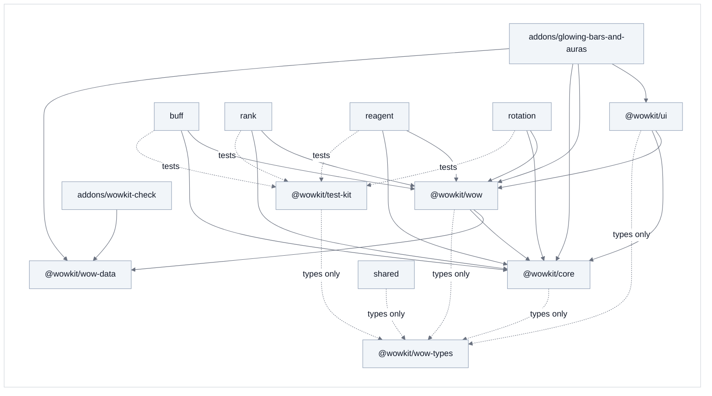

# Packages and addons

The repository holds **packages** (what could serve any Forever addon) and **addons** (what uses them). Why it is
split this way: [architecture.md](architecture.md#architecture-decision-records-adr), which also describes how an addon itself is built.

```
packages/
  @wowkit/                       the toolkit, for any Forever addon
    core/        Addon, decorators, EventBus, lifecycle hooks, text helpers
    wow/         the services that talk to the game
    ui/          settings, texts, chat lines, sounds and the Settings panel pages
    wow-types/   Blizzard's API as TypeScript types (generated + hand-written)
    wow-data/    the spell and item IDs the addons use, by category, and what the client said of them
    test-kit/    describe / it / expect, the fake game and its fixtures
addons/
  glowing-bars-and-auras/ GlowingBarsAndAuras the addon: buffs, old ranks, reagents, ready cooldowns and procs, as glows on the bars
  wowkit-check/       WowkitCheck        developer tool, not released: checks the IDs of wow-data against the client
scripts/                               build, deploy, type generation, the rule checks
```

An addon is a folder with `src/`, `test/`, `addon/` (the TOC), `assets/logo.png`, a `package.json` and two
`tsconfig` files. The game loads each as a separate addon, with its own saved settings.

## Who may import whom



- A package imports **only itself and the packages it depends on**: `core` and `test-kit` depend on nothing,
  `wow` on `core` and `wow-data`, `ui` on `core` and `wow`, `shared` on `core`, `wow` and `wow-data`. The typings are not imported at all; they are global types the compiler includes.
- An addon may use every package. What only an addon knows (its buff lists, its texts, the shape of its settings) reaches
  a package as a constructor parameter or a type parameter, passed in by the addon's `addon.ts`.
- `pnpm check` enforces it: `scripts/check-layers.ts` (imports), `scripts/check-boundary.ts` (only `packages/@wowkit/wow`,
  `packages/@wowkit/core`, `packages/@wowkit/ui` and the `options/` folders of the addons call the game) and
  `scripts/check-wiring.ts` (every service of an addon is made in its `addon.ts`).

## What is in the packages

| Package | What an addon gets |
|---|---|
| `@wowkit/core` | `Addon` (registers the services, starts them), `@OnGameEvent`, `@OnUnitEvent`, `@OnEvent`, `@Interval`, the lifecycle hooks, the `EventBus`. |
| `@wowkit/wow` | The game's door and nothing else: player, character, other units (the target), party, bags, spells and the spell book, spell details and cooldowns, auras, action bars, totems, weapon enchants, glows (also faded by a hidden value), notices, saved variables, the clock; `SpellRefreshService` and `BarRefreshService` keep the spells and the bars fresh. |
| `@wowkit/wow-data` | The spell and item IDs the addons use, by category, written in one place (`Paladin`, `Shaman`, `Priest`, `Reagents`...), and what the client said of them. |
| `@wowkit/ui` | `SettingsService<T>` (the shape is the addon's), `LocaleService<K>`, `MessagesService` and the sounds, `GreetingService`, and for the Settings panel `OptionsService` (one main page), `AboutSection` (the Help section), `ControlsService<T>` and `WidgetsService`. |
| `@wowkit/test-kit` | `describe` / `it` / `expect`, `createWorld` (a fake game, with a target to fight), and fixtures: the classes and spells the specs use. |

## How an addon uses them

The addon's `tsconfig.json` maps each package name to its sources, so TypeScriptToLua compiles the packages together
with the addon into one Lua file:

```jsonc
"paths": {
  "@wowkit/core": ["../../packages/@wowkit/core/src/index.ts"],
  "@wowkit/core/*": ["../../packages/@wowkit/core/src/*"],   // only for `declare module` blocks that add an event
  "@wowkit/wow": ["../../packages/@wowkit/wow/src/index.ts"],
  "@wowkit/ui": ["../../packages/@wowkit/ui/src/index.ts"],
  "@wowkit/wow-data": ["../../packages/@wowkit/wow-data/src/index.ts"]
},
"include": ["src/**/*.ts", "../../packages/@*/*/src/**/*.ts", "../../packages/@wowkit/wow-types/**/*.d.ts"]
```

The tests have their own project (`tsconfig.test.json`) with `@wowkit/test-kit`. Each package also has a small
`tsconfig.json` so the editor knows which project its files belong to; the build never reads them.

## The workspace

The repository is a **pnpm workspace** (see [why](architecture.md#architecture-decision-records-adr)): `pnpm-workspace.yaml` lists
`packages/*` and `addons/*`, and each has its own `package.json`. The tools (TypeScript, TypeScriptToLua, ESLint,
Prettier) are installed once, at the root.

```sh
pnpm install                                    # once
pnpm test                                       # checks, then build, build the tests and run them, for every addon
pnpm --filter glowing-bars-and-auras build               # one addon
pnpm --filter glowing-bars-and-auras deploy:game         # build it and copy it into the game (WOW_ADDONS_DIR)
```

The packages are listed as `workspace:*` dependencies, which records who depends on whom. Compiling does not use
the links pnpm makes in `node_modules`: TypeScriptToLua cannot compile sources from there, so the `paths` of the
`tsconfig` files (above) stay.

## A new addon

1. Copy `addons/glowing-bars-and-auras` (or, for a smaller start, `addons/rank-reminder` as it was at the tag
   `rank-reminder-v1.0.2`: a Settings page and a notice) to `addons/<name>`, and rename it in `package.json` (`name`, `addon.name`), in the `tsconfig` files (the bundle name and `outDir`), in the
   TOC and in `src/main.ts`. Give it a `## Category:` in the TOC: the game groups addons of one category under a collapsible header in its
   addon list.
2. Write its settings (`settings.interface.ts`, `settings.constants.ts`), its texts and its services; make them in
   `src/addon.ts`, dependencies first.
3. Draw `assets/logo.png` (square, a multiple of 128 px): the build makes the game's TGA icon from it.
4. Nothing in the packages changes. If a package service needs something only the new addon knows, it takes it as a
   constructor parameter, as the existing ones do.

The shared scripts work on the folder they are started in, and the checks look at every folder under `addons/`.

## Publishing, when it comes

Not done, and not needed until another repository wants the packages. It takes:

- the `private` flag off in each package's `package.json`, `peerDependencies` on `@wowkit/core` for `wow` and
  `ui` (so two copies of the core's notes never end up in one bundle), and a license;
- library builds (`"buildMode": "library"`, `"declaration": true`) so an addon imports the built Lua from
  `node_modules` (the route that works from `node_modules`);
- the typings package listed in the consumer's `tsconfig.json` `types`;
- a license, semantic versions, a changelog, and answers to issues.

## Open questions

- **Does the Lua bundle repeat TypeScriptToLua's helper functions per library build?** Not measured; with route A
  there is one bundle and no repetition.
- **Tests of the other packages.** `core` and `wow` have specs of their own (`packages/*/test`), made with the
  `createBasicGame` of the test kit and stubs for what a service asks of its neighbours (a service takes its
  dependencies in the constructor, so a stub can stand in). `ui` has none of its own yet: its pages and controls are
  tested through the addons.
- **Several addons, one client.** Each addon reads the spells and the action bars for itself. Two addons that map the bars
  do the same work twice; the mapping is throttled and done a few buttons per frame, so two at once have not shown a
  problem. The
  on-screen notice is the one thing the addons share: one frame, a block of lines per addon (see `packages/@wowkit/wow`).
