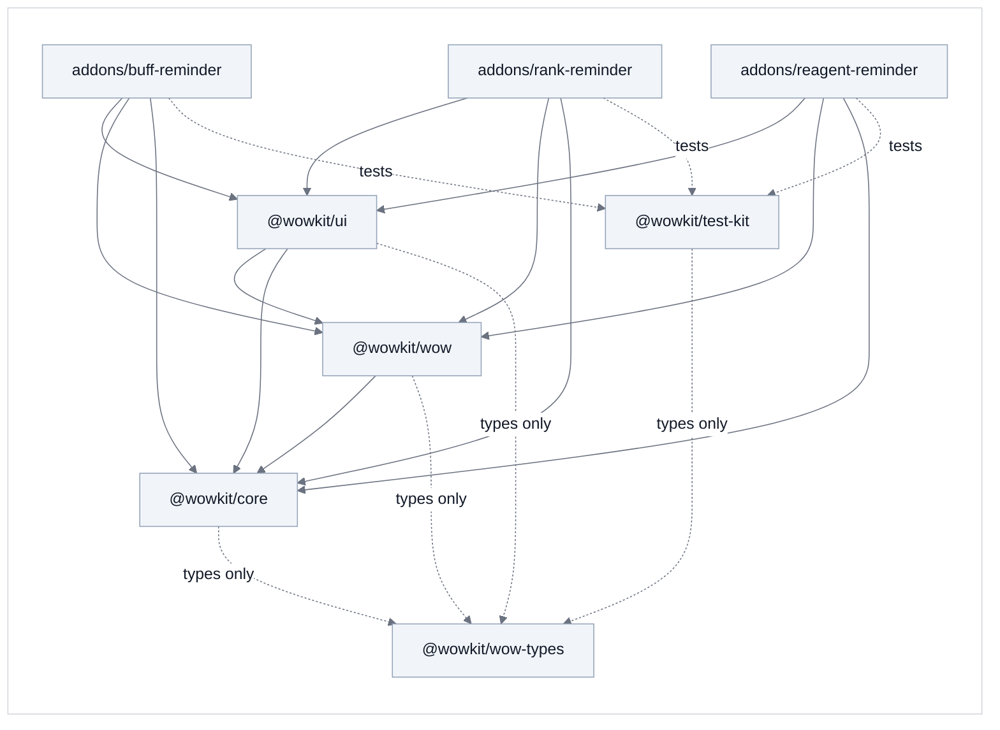

# Packages and addons

The repository holds **packages** (what could serve any Forever addon) and **addons** (what uses them). Why it is
split this way, and what was tried: [0012](decisions/0012-packages.md), [0013](decisions/0013-pnpm-workspace.md) and
[0014](decisions/0014-three-addons-and-the-ui-package.md). How an addon itself is built:
[architecture.md](architecture.md).

```
packages/
  core/        @wowkit/core    Addon, decorators, EventBus, lifecycle hooks, text helpers
  wow/         @wowkit/wow          the services that talk to the game
  ui/          @wowkit/ui           settings, texts, chat lines, sounds and the Settings panel pages
  wow-types/   @wowkit/wow-types    Blizzard's API as TypeScript types (generated + hand-written)
  test-kit/    @wowkit/test-kit     describe / it / expect, the fake game and its fixtures
addons/
  buff-reminder/     BuffReminder      missing buffs, weapon buffs, party buffs, buffs not on the bars
  rank-reminder/     RankReminder      spells on the bars at an old rank
  reagent-reminder/  ReagentReminder   low reagents on arriving in a town or an inn
scripts/                               build, deploy, type generation, the rule checks
```

Each addon is a folder with `src/`, `test/`, `addon/` (the TOC), `assets/logo.png`, a `package.json` and two
`tsconfig` files. The game loads each as a separate addon, with its own saved settings.

## Who may import whom



- A package imports **only itself and the packages it depends on**: `core` and `test-kit` depend on nothing,
  `wow` on `core`, `ui` on both. The typings are not imported at all; they are global types the compiler includes.
- An addon may use every package. What only an addon knows (its buff lists, its texts, the shape of its settings) reaches
  a package as a constructor parameter or a type parameter, passed in by the addon's `addon.ts`.
- `pnpm check` enforces it: `scripts/check-layers.ts` (imports), `scripts/check-boundary.ts` (only `packages/wow`,
  `packages/core`, `packages/ui` and the `options/` folders of the addons call the game) and
  `scripts/check-wiring.ts` (every service of an addon is made in its `addon.ts`).

## What is in the packages

| Package | What an addon gets |
|---|---|
| `@wowkit/core` | `Addon` (registers the services, starts them), `@OnGameEvent`, `@OnUnitEvent`, `@OnEvent`, `@Interval`, the lifecycle hooks, the `EventBus`. |
| `@wowkit/wow` | The game's door: player, party, bags, spells and the spell book, auras, action bars, weapon enchants, glows, notices, saved variables, the clock; `ReagentsService` and the spell IDs; `SpellRefreshService` and `BarRefreshService` keep the spells and the bars fresh. |
| `@wowkit/ui` | `SettingsService<T>` (the shape is the addon's), `LocaleService<K>`, `MessagesService` and the sounds, `GreetingService`, and for the Settings panel `OptionsService` (one main page), `AboutSection` (the Help section), `ControlsService<T>` and `WidgetsService`. |
| `@wowkit/test-kit` | `describe` / `it` / `expect`, `createWorld` (a fake game), and fixtures: the classes and spells the specs use. |

## How an addon uses them

The addon's `tsconfig.json` maps each package name to its sources, so TypeScriptToLua compiles the packages together
with the addon into one Lua file:

```jsonc
"paths": {
  "@wowkit/core": ["../../packages/core/src/index.ts"],
  "@wowkit/core/*": ["../../packages/core/src/*"],   // only for `declare module` blocks that add an event
  "@wowkit/wow": ["../../packages/wow/src/index.ts"],
  "@wowkit/ui": ["../../packages/ui/src/index.ts"]
},
"include": ["src/**/*.ts", "../../packages/*/src/**/*.ts", "../../packages/wow-types/**/*.d.ts"]
```

The tests have their own project (`tsconfig.test.json`) with `@wowkit/test-kit`. Each package also has a small
`tsconfig.json` so the editor knows which project its files belong to; the build never reads them.

## The workspace

The repository is a **pnpm workspace** ([0013](decisions/0013-pnpm-workspace.md)): `pnpm-workspace.yaml` lists
`packages/*` and `addons/*`, and each has its own `package.json`. The tools (TypeScript, TypeScriptToLua, ESLint,
Prettier) are installed once, at the root.

```sh
pnpm install                                    # once
pnpm test                                       # checks, then build, build the tests and run them, for every addon
pnpm --filter buff-reminder build               # one addon
pnpm --filter buff-reminder deploy:game         # build it and copy it into the game (WOW_ADDONS_DIR)
```

The packages are listed as `workspace:*` dependencies, which records who depends on whom. Compiling does not use
the links pnpm makes in `node_modules`: TypeScriptToLua cannot compile sources from there, so the `paths` of the
`tsconfig` files (above) stay.

## A new addon

1. Copy `addons/rank-reminder` (the smallest one that has a Settings page and a notice) to `addons/<name>`, and
   rename it in `package.json` (`name`, `addon.name`), in the `tsconfig` files (the bundle name and `outDir`), in the
   TOC and in `src/main.ts`. Keep `## Category: Reminders` in the TOC if it is a reminder: the game groups addons of one
   category under a collapsible header in its addon list.
2. Write its settings (`settings.interface.ts`, `settings.constants.ts`), its texts and its services; make them in
   `src/addon.ts`, dependencies first.
3. Draw `assets/logo.png` (square, a multiple of 128 px): the build makes the game's TGA icon from it.
4. Nothing in the packages changes. If a package service needs something only the new addon knows, it takes it as a
   constructor parameter, as the existing ones do.

The shared scripts work on the folder they are started in, and the checks look at every folder under `addons/`.

## Publishing, when it comes

Not done, and not needed until another repository wants the packages. It takes:

- the `private` flag off in each package's `package.json`, `peerDependencies` on `@wowkit/core` for `wow` and
  `ui` (so two copies of the core's notes never end up in one bundle), and a license;
- library builds (`"buildMode": "library"`, `"declaration": true`) so an addon imports the built Lua from
  `node_modules` (route C of [0012](decisions/0012-packages.md));
- the typings package listed in the consumer's `tsconfig.json` `types`;
- a license, semantic versions, a changelog, and answers to issues ([0006](decisions/0006-tooling.md)).

## Open questions

- **Does the Lua bundle repeat TypeScriptToLua's helper functions per library build?** Not measured; with route A
  there is one bundle and no repetition.
- **Tests of the packages themselves.** Today all tests are specs of the addons, run against the fake game. The
  `Addon` class (hook order, intervals), the `EventBus`, `SpellRefreshService` and `BarRefreshService` have no tests of
  their own; a tiny test addon per package would give them.
- **Several addons, one client.** Each addon reads the spells and the action bars for itself. An addon that maps the
  bars (buff-reminder, rank-reminder) does the same work as the other; the mapping is throttled and done a few buttons
  per frame, so two at once have not shown a problem, but it has not been measured with all three in the game.
