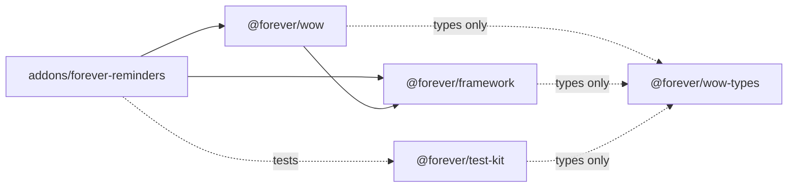

# Packages and addons

The repository holds **packages** (what could serve any Forever addon) and **addons** (what uses them). Why it is
split this way, and what was tried: [0012](decisions/0012-packages.md). How the addon itself is built:
[architecture.md](architecture.md).

```
packages/
  framework/   @forever/framework    Addon, decorators, EventBus, lifecycle hooks, text helpers
  wow/         @forever/wow          the services that talk to the game
  wow-types/   @forever/wow-types    Blizzard's API as TypeScript types (generated + hand-written)
  test-kit/    @forever/test-kit     describe / it / expect and the fake game
addons/
  forever-reminders/                 src/, test/, addon/ (the TOC), tsconfig.json, tsconfig.test.json
scripts/                             build, deploy, type generation, the rule checks
```

## Who may import whom



- A package imports **only itself and the packages it depends on**: `framework` and `test-kit` depend on nothing,
  `wow` on `framework`. The typings are not imported at all; they are global types the compiler includes.
- The addon may use every package. What only the addon knows (buff categories, spell names, the name of the saved
  variable) reaches a package as a constructor parameter, passed in by `addon.ts`.
- `pnpm check` enforces it: `scripts/check-layers.ts` (imports), `scripts/check-boundary.ts` (only
  `packages/wow`, `packages/framework` and the addon's `options/` and `diagnostics/` call the game) and
  `scripts/check-wiring.ts` (every service is made in `addon.ts`).

## How an addon uses them

The addon's `tsconfig.json` maps each package name to its sources, so TypeScriptToLua compiles the packages
together with the addon into one Lua file:

```jsonc
"paths": {
  "@forever/framework": ["../../packages/framework/src/index.ts"],
  "@forever/framework/*": ["../../packages/framework/src/*"],   // only for `declare module` blocks that add an event
  "@forever/wow": ["../../packages/wow/src/index.ts"]
},
"include": ["src/**/*.ts", "../../packages/framework/src/**/*.ts", "../../packages/wow/src/**/*.ts", "../../packages/wow-types/**/*.d.ts"]
```

The tests have their own project (`tsconfig.test.json`) with `@forever/test-kit`. Each package also has a small
`tsconfig.json` so the editor knows which project its files belong to; the build never reads them.

## What a second addon would take

1. A folder `addons/<name>/` with the same shape: `src/` (with its own `addon.ts` that makes its services),
   `test/`, `addon/` (the TOC), and the two `tsconfig` files with the same `paths`.
2. Its `package.json` names it (`addon.name`, `version`) and has the same scripts. The shared scripts work on the
   folder they are started in, and the checks look at every folder under `addons/`.
3. Nothing in the packages changes. If a service of `@forever/wow` needs something only the new addon knows, it
   takes it as a constructor parameter like the first one does.

## The workspace

The repository is a **pnpm workspace** ([0013](decisions/0013-pnpm-workspace.md)): `pnpm-workspace.yaml` lists
`packages/*` and `addons/*`, and each has its own `package.json`. The tools (TypeScript, TypeScriptToLua, ESLint,
Prettier) are installed once, at the root.

```sh
pnpm install                                  # once
pnpm test                                     # checks, then build, build the tests and run them, for every addon
pnpm --filter forever-reminders build         # one addon
pnpm --filter forever-reminders deploy:game   # build and copy it into the game (WOW_ADDONS_DIR)
```

The packages are listed as `workspace:*` dependencies, which records who depends on whom. Compiling does not use
the links pnpm makes in `node_modules`: TypeScriptToLua cannot compile sources from there, so the `paths` of the
`tsconfig` files (above) stay.

## Publishing, when it comes

Not done, and not needed until another repository wants the packages. It takes:

- the `private` flag off in each package's `package.json`, `peerDependencies` on `@forever/framework` for `wow` (so
  two copies of the framework's notes never end up in one bundle), and a license;
- library builds (`"buildMode": "library"`, `"declaration": true`) so an addon imports the built Lua from
  `node_modules` (route C of [0012](decisions/0012-packages.md));
- the typings package listed in the consumer's `tsconfig.json` `types`;
- a license, semantic versions, a changelog, and answers to issues ([0006](decisions/0006-tooling.md)).

## Open questions

- **Does the Lua bundle repeat TypeScriptToLua's helper functions per library build?** Not measured; with route A
  there is one bundle and no repetition.
- **Tests of the packages themselves.** Today all tests are specs of the addon, run against the fake game. The
  `Addon` class (hook order, intervals), the `EventBus` and `@OnEvent` handlers such as `AurasService`'s have no
  tests of their own; a tiny test addon per package would give them.
